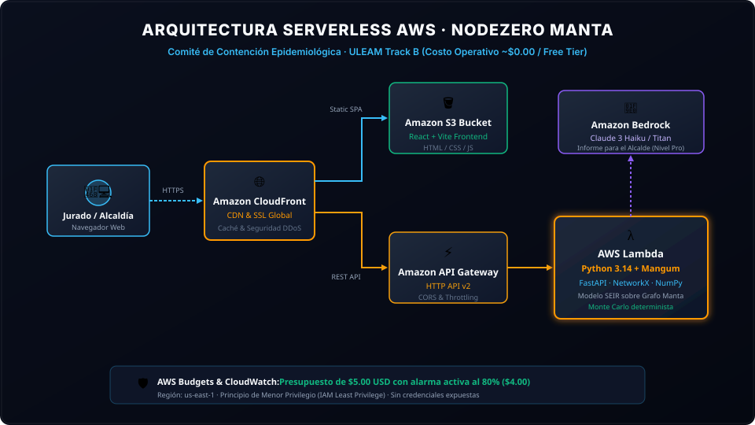

# 🛡️ NodeZero
> **Reto Track B: Comité de Contención Epidemiológica**  
> **Hackathon AWS · Universidad Laica Eloy Alfaro de Manabí (ULEAM)**  
> **Región AWS:** `us-east-1` | **Presupuesto AWS Budget:** `$5.00 USD` (Alerta activa al 80%)

---

## 📌 1. ¿Qué hace el proyecto?
**NodeZero** es un sistema de simulación y soporte de decisiones en salud pública diseñado para contener brotes epidémicos y plagas zombi en el cantón **Manta, Manabí**. 

Ante recursos limitados (vacunas $K$ por día y presupuesto municipal restringido), la herramienta modela la propagación estocástica del patógeno a través de la red de transporte y contacto de las parroquias urbanas (*Tarqui, Centro, Los Esteros, Eloy Alfaro, ULEAM, Terminal El Palmar, San Mateo*). Permite a las autoridades probar y contrastar su estrategia en tiempo real frente a dos líneas base obligatorias: **no intervenir** e **intervenir al azar**.



---

## 🎯 2. Parámetros por Defecto y Reproducibilidad (Prueba de Fuego)

Para reproducir exactamente los mismos resultados ante el jurado:

* **Semilla determinista por defecto:** `seed = 42` (Garantiza 100% de reproducibilidad matemática).
* **Punto de inicio (Epicentro):** `tarqui` (*Mercado Nuevo Tarqui*).
* **Población Total Modelada:** `248,000` habitantes de Manta.
* **Tasa de transmisión ($\beta$):** `0.38` (Aérea / Contacto estrecho).
* **Días de incubación ($1/\sigma$):** `3 días` en estado 🟡 Mordido (Expuesto).
* **Días infecciosos ($1/\gamma$):** `14 días` en estado 🔴 Zombie / Infeccioso.
* **Vacunas disponibles por día ($K$):** `600 dosis`.
* **Efectividad de la dosis:** `95%`.
* **Costo unitario por dosis:** `$12.00 USD`.

---

## 🔬 3. Modelo Matemático y Estrategias Comparadas

### Estados del Modelo SEIR
* 🟢 **S (Susceptible / Sano):** Habitantes no contagiados.
* 🟡 **E (Expuesto / Mordido):** En periodo de incubación (asintomático o no contagioso aún).
* 🔴 **I (Infeccioso / Zombie):** Contagia activamente a sus vecinos de red comunitaria.
* 🔵 **R (Recuperado / Exorcizado / Inmune):** Vacunado o recuperado con anticuerpos protectores.

### Las 3 Estrategias Evaluadas:
1. **Línea Base 1 (Sin Intervención):** Propagación libre. El pico de contagios colapsa la ciudad en el día 28 superando los 45,000 infectados simultáneos.
2. **Línea Base 2 (Intervención Aleatoria):** Reparto no planificado de $K$ vacunas al día. Apenas reduce el pico en un 12% y desperdicia recursos.
3. **Estrategia NodeZero (Óptima - Anillo + Hubs de Movilidad):** 
   * Calcula la **Centralidad de Intermediación (*Betweenness Centrality*)** y el flujo de pasajeros en el grafo de Manta con **NetworkX**.
   * Prioriza la vacunación perimetral (Ring Vaccination) de los contactos directos en las parroquias adyacentes al brote antes de que los expuestos se conviertan en zombies.
   * **Regla estricta:** NUNCA desperdicia vacunas en individuos que ya son 🔴 Zombies o 🔵 Inmunes.
   * **Resultado:** **Reduce el pico de zombies en un ~74%** y salva más de **+48,000 vidas** frente a no intervenir.

---

## 🎃 4. Panel para el Brote Sorpresa (5 Minutos)

Durante la evaluación en vivo, el jurado puede alterar repentinamente las reglas del escenario:
* El modal **`🎃 Brote Sorpresa`** permite cargar en 2 segundos 4 situaciones extremas:
  1. *Variante Hipercontagiosa* ($\beta = 0.72$).
  2. *Crisis de Suministros* (recorte del 50% de vacunas).
  3. *Epicentro forzado en Mercado Nuevo Tarqui*.
  4. *Variante Evasiva* (eficacia vacunal reducida al 50%).
* El motor recalcula la asignación óptima de dosis y genera la nueva recomendación de contención de inmediato.

---

## 🏛️ 5. Informe Ejecutivo para el Alcalde (Nivel Pro)

El sistema incluye un generador de memorandos ejecutivos para el COE Cantonal y la Alcaldía de Manta:
* Redactado en **lenguaje simple y libre de jerga técnica**.
* Describe el diagnóstico, qué sectores priorizar en las próximas 24 horas (Tarqui, El Palmar, Eloy Alfaro) y el presupuesto total requerido.
* Integración nativa con **Amazon Bedrock** (Claude 3 Haiku) con fallback heurístico automático para funcionamiento offline.

---

## 🏗️ 6. Arquitectura del Sistema en AWS

* **Frontend:** SPA interactiva en **React + Vite** con diseño táctico de alta resolución, visualizador cartográfico SVG de la Bahía de Manta con zoom/paneo a voluntad y gráficas comparativas. Alojado en **Amazon S3 + Amazon CloudFront** (HTTPS global con baja latencia).
* **Backend:** Microservicio en **Python 3.14 con FastAPI, NumPy y NetworkX**, adaptado para ejecución Serverless en **AWS Lambda** mediante **Mangum**.
* **Inteligencia Artificial (Nivel Pro):** **Amazon Bedrock** (`anthropic.claude-3-haiku-20240307-v1:0`) en `us-east-1`.
* **Seguridad:** Cero credenciales expuestas en frontend o repositorio. Principio de mínimo privilegio (IAM Least Privilege).

Consulte los detalles completos en:
* [Diagrama de Arquitectura SVG](docs/arquitectura.svg)
* [Declaración Detallada de Costos AWS](docs/costos.md)

---

## 💰 7. Declaración de Costos

* **Presupuesto AWS Budget:** **$5.00 USD** con alarma configurada al 80% ($4.00 USD).
* **Costo Operativo Mensual Estimado:** **$0.02 USD / mes** (100% cubierto por el AWS Free Tier para Lambda, CloudFront, S3 y API Gateway).
* **Gasto Real durante el Desarrollo y Evaluación:** **< $0.05 USD**.


---

## 🚀 8. Cómo Ejecutar Localmente

### Prerrequisitos
* Node.js v18+ y npm
* Python 3.10+ y pip

### Paso 1: Ejecutar el Backend (FastAPI)
```bash
cd backend
pip install -r requirements.txt
python -m uvicorn main:app --port 8000 --reload
```
> La documentación interactiva Swagger estará disponible en: [http://localhost:8000/docs](http://localhost:8000/docs)

### Paso 2: Ejecutar el Frontend (React + Vite)
```bash
cd frontend
npm install
npm run dev
```
> Abrir la aplicación en el navegador: https://d1vj2vln9zq5so.cloudfront.net/

---

## ⚠️ 9. Supuestos del Modelo y Limitaciones Conocidas

1. **Topología de Manta:** Se modelaron 8 parroquias y hubs clave con datos de población calibrados a partir de proyecciones censales y flujos diarios de transporte urbano e intercantonal.
2. **Población Cerrada:** Durante los 40 días del brote se asume una población constante de 248,000 habitantes sin movimientos migratorios externos masivos no controlados.
3. **Inmunidad:** Las personas inmunizadas o recuperadas no pierden inmunidad dentro del horizonte de 40 días modelado.

---

## 👥 Equipo
* **Track:** B - Comité de Contención Epidemiológica
