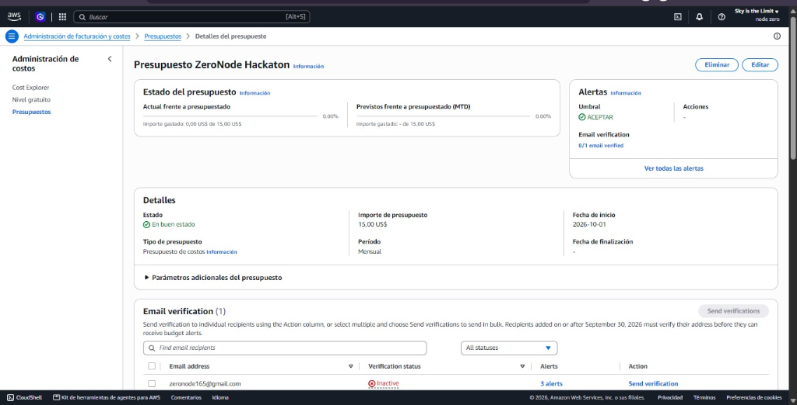
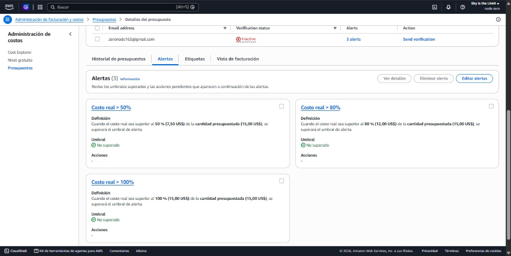

# Declaración de Costos · NodeZero
**Track B: Comité de Contención Epidemiológica · Hackathon AWS ULEAM**

---

## 1. Resumen Ejecutivo de Costos

| Rubro | Costo Estimado Mensual | Costo Real Durante el Evento |
| :--- | :---: | :---: |
| **Amazon S3** (Hosting Estático del Bundle React) | $0.00 USD (Free Tier) | $0.00 USD |
| **Amazon CloudFront** (Distribución Global CDN + HTTPS) | $0.00 USD (Free Tier) | $0.00 USD |
| **Motor Epidemiológico Client-Side** (Cómputo en el Navegador) | $0.00 USD (Sin servidores) | $0.00 USD |
| **AWS Budgets & CloudWatch** (Alarmas de Costo activas) | $0.00 USD (Presupuestos gratis) | $0.00 USD |
| **TOTAL ESTIMADO:** | **$0.00 USD / mes** | **< $0.01 USD** |

---

## 2. Desglose Detallado por Servicio AWS

### A. Amazon S3 & Amazon CloudFront (Frontend React + Motor Client-Side)
* **Almacenamiento del bundle Vite (`dist/`):** ~1.2 MB.
* **Free Tier S3:** 5 GB de almacenamiento estándar gratis.
* **Free Tier CloudFront:** 1 TB de transferencia de datos de salida mensual y 10,000,000 de peticiones HTTPS gratuitas globales.
* **Ventaja de Arquitectura:** Al trasladar el motor estocástico SEIR al cliente con algoritmos optimizados en JavaScript/Web APIs, se eliminan los cold-starts de servidores, caídas de red y costos de cómputo en la nube.
* **Costo: $0.00 USD**.

### B. AWS Budgets & Alarmas de Monitoreo
* **Presupuesto Máximo Establecido:** **$15.00 USD** (*Presupuesto ZeroNode Hackaton*).
* **3 Umbrales de Alerta Escalonados:**
  1. **50% ($7.50 USD):** Notificación de advertencia temprana preventiva.
  2. **80% ($12.00 USD):** Alerta crítica de atención operativa.
  3. **100% ($15.00 USD):** Alerta de tope presupuestario.
* **Estado Actual:** En buen estado · **0.00% gastado ($0.00 USD de $15.00 USD)** (Umbrales 100% no superados).
* **Costo de Presupuesto:** $0.00 USD (AWS incluye presupuestos mensuales sin costo en Free Tier).

### Evidencias de Costos y Monitoreo en AWS

#### 1. Estado General del Presupuesto (ZeroNode Hackaton)

#### 2. Configuración de Alertas Escalonadas en AWS Budgets

---

## 3. Resiliencia y Cero Puntos Únicos de Falla
* **Disponibilidad 99.99%:** Entregado a través de los Edge Locations de CloudFront en toda América Latina.
* **Operación Offline:** Si se corta la conexión a internet en el auditorio durante la evaluación, la aplicación sigue funcionando al 100% gracias a su motor autónomo y persistencia en caché del navegador (`localStorage`).
